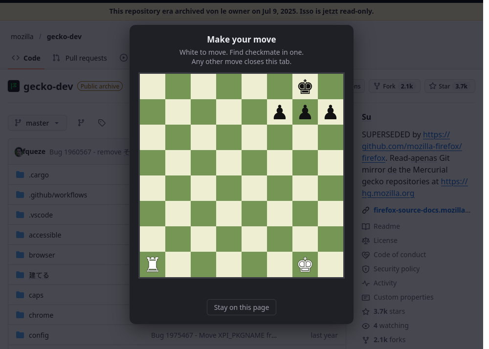

# makeInternetWorse

A Firefox extension that makes the web a little stranger:

- **Word shuffle**: random words on every page are swapped into Spanish, French, German, Italian, Portuguese or Japanese. Hover a swapped word (dotted underline) to see the original.
- **Chess gate**: clicking a link shows a mate-in-one chess puzzle. Find the checkmate and the link opens. Play any other move and **the tab closes**.



## Features

- 530+ word offline dictionary. Nothing is sent over the network.
- Matches word forms roughly ("running" → *correr*, "cities" → *ciudad*) and keeps the original capitalization.
- Leaves code blocks, text inputs and editable areas alone, and handles content that loads after the page does.
- 300 generated mate-in-one puzzles, checked by a small built-in chess engine. Any checkmating move wins, and illegal moves are blocked.
- Toolbar popup to turn each feature on or off, set the swap rate, pick languages, and reshuffle the current page.

## Install

### From addons.mozilla.org

*Not listed yet.* See [Publishing to Firefox](#publishing-to-firefox).

### From source (temporary, for trying it out)

1. Clone this repo: `git clone https://github.com/willmac321/makeInternetWorse.git`
2. In Firefox, open `about:debugging#/runtime/this-firefox`.
3. Click **Load Temporary Add-on…** and choose `src/manifest.json`.

Temporary add-ons are removed when Firefox restarts.

## Usage

Click the toolbar icon to open the settings:

| Setting | What it does |
| --- | --- |
| Enabled | Turns word swapping on or off |
| Chess gate on links | Turns the link puzzle on or off |
| Swap rate | Percentage of known words that get swapped |
| Languages | Which languages to swap words into |
| Reshuffle this page | Picks a new random set of swaps |

In the chess gate, press **Esc** or **Stay on this page** to close the puzzle without following the link. That never closes the tab.

The chess gate only catches normal left-clicks on links. Typed URLs, bookmarks, back/forward, and Ctrl/middle-clicks into new tabs skip it.

## Permissions

| Permission | Why |
| --- | --- |
| Access to all websites | Swap words and show the chess gate on any page |
| `scripting` | Load into tabs that were already open when the extension is installed or updated |
| `storage` | Save your settings |

The extension collects no data and makes no network requests.

## Development

Requires [Node.js](https://nodejs.org/) 18+ and Firefox.

```sh
npm install        # installs web-ext (Mozilla's extension tool)
npm start          # opens a fresh Firefox profile with the extension loaded, reloads on save
npm test           # chess engine, puzzle and dictionary checks
npm run lint       # the same checks addons.mozilla.org runs on upload
npm run build      # creates dist/makeinternetworse-<version>.zip
```

### Project layout

```
src/                  everything that ships in the extension
  manifest.json
  dictionary.js       word list: English → 6 languages
  content.js          finds words on the page and swaps them
  content.css         dotted underline on swapped words
  chess-engine.js     chess move rules and checkmate detection
  puzzles.js          puzzle positions (generated)
  chess.js            link interception and the puzzle UI
  background.js       closes the tab on a loss; loads into already-open tabs
  popup.html/.css/.js toolbar settings popup
  icons/
tools/
  generate-puzzles.js regenerates src/puzzles.js
  test.js             tests run by `npm test`
```

See [CONTRIBUTING.md](CONTRIBUTING.md) for how to add words, languages and puzzles.

## Publishing to Firefox

Firefox only installs extensions that Mozilla has signed. There are two ways to get one signed.

### Option A: List it on addons.mozilla.org (AMO)

Anyone can find and install it from AMO, and Firefox auto-updates it.

1. **Bump the version** in `src/manifest.json` (and `package.json` to match). AMO rejects a version number it has seen before.
2. **Check and build:**
   ```sh
   npm test && npm run lint && npm run build
   ```
   Lint must report **0 errors**. Fix any warnings too, since reviewers see them.
3. **Sign in** at the [Add-on Developer Hub](https://addons.mozilla.org/developers/) with a Firefox account.
4. Click **Submit a New Add-on**, choose **On this site**, and upload `dist/makeinternetworse-<version>.zip`.
5. **Platforms:** choose Firefox. Also tick Firefox for Android only if you've tested it there.
6. **Source code:** answer **No**. Nothing in `src/` is minified or bundled, so reviewers can read it as-is.
7. **Listing details:** name, summary, a category (e.g. *Fun*), a license, and screenshots (`docs/chess-gate.png` works).
   Say clearly in the description that the extension **intercepts link clicks and can close the tab**. Reviewers check that surprising behavior is disclosed.
8. Submit. Automated checks run straight away. A human review may follow and can take anywhere from hours to a few weeks.

**To release an update:** bump the version, rebuild, then go to the Developer Hub, open the add-on, and choose **Upload New Version**.

The add-on ID `makeinternetworse@loblollysoftware.com` in `manifest.json` identifies this extension on AMO forever. Don't change it after the first upload.

### Option B: Self-distribute a signed `.xpi`

Use this to install it permanently yourself, or share the file directly, without an AMO listing.

1. Create API credentials at <https://addons.mozilla.org/developers/addon/api/key/>.
2. Run:
   ```sh
   npx web-ext sign --source-dir src --channel unlisted \
     --api-key "$AMO_JWT_ISSUER" --api-secret "$AMO_JWT_SECRET"
   ```
3. The signed `.xpi` lands in `web-ext-artifacts/`. Drag it into Firefox to install.

Keep your API key and secret out of git. Use environment variables, not files in the repo.
